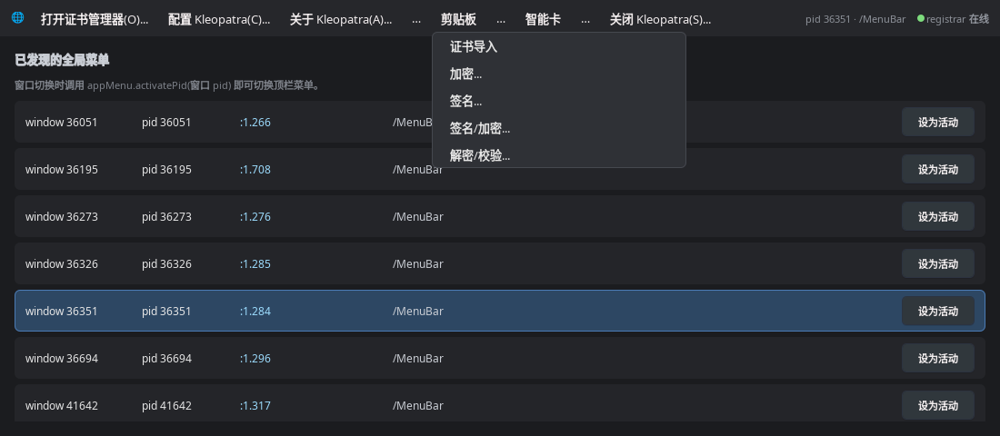

# 全局菜单（appmenu）

Wayland / Hyprland 下的 D-Bus 全局菜单，**纯 Qt QML 模块**：没有守护进程、没有可
执行文件、工程里也没有 `.qml` 文件（测试除外），`import` 之后 `AppMenu` 就能用。

结论先行：**没有"纯 Wayland 的全局菜单协议"**，菜单数据永远走
`com.canonical.dbusmenu`。`org_kde_kwin_appmenu` 只是把 surface 关联到总线上已
注册的菜单对象，而且 Hyprland 不实现它。所以这里走的是
"**占住 registrar 名字 + 自己发现**"的路线，不依赖任何合成器插件。

## 它解决什么问题

Qt 的 `QGenericUnixTheme` 只有在会话总线上存在 `com.canonical.AppMenu.Registrar`
时才会创建 `QDBusMenuBar`，应用才会把菜单树导出到 D-Bus。**没人占这个名字，
菜单根本不会出现在总线上。**

而 Wayland 下没有 X11 XID，`RegisterWindow(windowId, path)` 永远不会被调用
（windowId 是 XID），所以"注册表"拿不到任何东西。本项目的解法是：

1. 占住 `com.canonical.AppMenu.Registrar`（让应用开始导出菜单）；
2. 监听 `NameOwnerChanged`，对每个总线连接 `Introspect /MenuBar`；
3. 用 `GetConnectionUnixProcessID` 把菜单和 **pid** 对应起来；
4. 面板侧按"活动窗口 pid"取菜单 —— 全程不需要 Wayland 协议。

### 为什么不需要单独的 registrar 守护进程

Qt 只关心"这条总线名有没有 owner"，不关心 owner 是谁。而这个模块本来就只在
面板/Quickshell 进程里活着、并且面板一直在跑，所以：

* `AppMenuService` 构造时**先试着自己占住** `com.canonical.AppMenu.Registrar`；
* 占到了 → `AppMenu.ownsRegistrar == true`，同时用同一套代码做菜单发现；
* 名字已被别人（KDE plasma、`memtable/hypr-appmenu`、另一个 Quickshell 实例）占着
  → 安静地退化成纯客户端，用对方的注册表。

想强制只当客户端（把占名让给别人的 registrar）：

```bash
APPMENU_NO_REGISTRAR=1 qs
```

实测（2026-10-19，Hyprland + KDE）：Quickshell 启动后自己就是 registrar
（`busctl --user status com.canonical.AppMenu.Registrar` 的 PID 就是 `qs` 的 PID），
总线上一共发现 9 份菜单，真实 Qt 应用的 `文件(F)|编辑(E)|视图(V)|…` 直接渲染出来。



*Kleopatra（libdbusmenu-qt，`/MenuBar`）的菜单由顶栏渲染，子菜单按需加载。*

## 目录结构

```
.
├── CMakeLists.txt            唯一的构建文件（库 + 安装 + 可选的测试）
├── src/
│   ├── types.h/.cpp          dbusmenu 线格式：(ia{sv}av) / (ia{sv}) / (uuss)
│   ├── dbusmenumodel.h/.cpp  QML 类型：一层菜单模型（com.canonical.dbusmenu 客户端）
│   ├── appmenuservice.h/.cpp QML 类型：pid → 菜单绑定 + 内嵌 registrar
│   ├── registrar.h/.cpp      registrar 实现（占名 + 发现 + 注册表，进程内）
│   └── appmenu.h/.cpp        QML 单例 AppMenu（C++ 实现）
├── test/                     测试 / 演示（唯一有 .qml 的地方，可关掉）
│   ├── fakeapp.cpp           假应用：导出 /MenuBar/1
│   ├── main.cpp              appmenu-test 入口
│   ├── Main.qml              顶栏演示
│   └── MenuPopup.qml         递归菜单弹窗
└── img/                      README 截图
```

QML 模块对外只有三个类型：

| 类型 | 说明 |
|---|---|
| `AppMenu` | 单例。`menuModel` / `activatePid()` / `menus` / `ownsRegistrar` … |
| `AppMenuService` | 普通可实例化对象，同一个 API，需要多个实例时用 |
| `DBusMenuModel` | 一层菜单的 `QAbstractListModel`，可被 Repeater/ListView 直接渲染 |

## D-Bus 契约

对象：`com.canonical.AppMenu.Registrar` @ `/com/canonical/AppMenu/Registrar`
（与 Qt 的 `qdbusmenubar.cpp`、`memtable/hypr-appmenu` 插件一致）。

| 方法 | 签名 | 说明 |
|---|---|---|
| `RegisterWindow` | `uo` | 标准接口。X11 下有 XID；Wayland 下 windowId 可能为 0，此时用 pid 代替 |
| `UnregisterWindow` | `u` | 标准接口。也接受 pid（hypr-appmenu 就是这么用的） |
| `GetMenus` | `→ a(uo)` | 标准接口：(windowId, path) |
| `GetMenuForWindow` | `u → o` | 标准接口 |
| `RegisterSurfaceMenu` | `uss` | **非标准**，hypr-appmenu 插件调用：(pid, service, path) |
| `GetMenuList` | `→ a(uuss)` | **扩展**：(windowId, pid, service, path) |
| `GetMenuForPid` | `u → (uuss)` | **扩展**，AppMenuService 用 |

信号：`WindowRegistered(u, s, o)`、`WindowUnregistered(u)`。

## 发现逻辑（关键细节）

现实中有两种导出方式，都要认：

| 实现 | 路径 | Version |
|---|---|---|
| Qt 内建 `QDBusMenuBar` | `/MenuBar/<n>` | 4 |
| `libdbusmenu-qt`（KDE 老应用）、GTK appmenu | `/MenuBar` 本身 | 2 |

所以探测时先 `Introspect /MenuBar`：XML 里有 `com.canonical.dbusmenu` 接口就收
`/MenuBar`，有子节点就收 `/MenuBar/<n>`。应用可能启动几秒后才建菜单栏，因此对
新出现的连接做有限次重试（2s × 15），之后每 60s 低频重扫一次没有菜单的连接。

## 构建与安装

```bash
cmake -S . -B build -DCMAKE_BUILD_TYPE=Release
cmake --build build -j$(nproc)
cmake --install build --prefix /usr        # 需要 root
```

默认装到 `${CMAKE_INSTALL_LIBDIR}/qt6/qml/com/github/yigekuyou/appmenu`
（和发行版的 Qt 6 包布局一致），`APPMENU_QML_DIR` 缓存变量可以改：

```bash
# 装给当前用户
cmake -S . -B build -DAPPMENU_QML_DIR=$HOME/.local/lib/qt6/qml/com/github/yigekuyou/appmenu
cmake --build build && cmake --install build

# 或者直接放进 Quickshell 的配置目录（配合 QML_IMPORT_PATH）
cmake -S . -B build -DAPPMENU_QML_DIR="$HOME/.config/quickshell/com/github/yigekuyou/appmenu"
cmake --build build && cmake --install build
```

装出来的是一个**自包含目录**（插件用 `$ORIGIN` 找 backing library，整目录可以原样拷走）：

```
com/github/yigekuyou/appmenu/
├── qmldir
├── appmenu.qmltypes
├── libappmenuplugin.so
└── libappmenu.so
```

构建产物：`build/com/github/yigekuyou/appmenu/`（模块）、
`build/test/appmenu-test`、`build/test/appmenu-fakeapp`（测试）。
不想要测试：`-DAPPMENU_BUILD_TESTS=OFF`。

### 在 Quickshell 里 import

Quickshell 的 `qs:` 是它自己的 URL scheme，**配置目录内的相对导入加载不了 C++ 插件**
（`import "com/..."`、`import qs.Stuff.AppMenu` 都会报
`module "…" plugin "appmenuplugin" not found`）。必须让引擎通过真正的文件系统
导入路径找到模块。模块装进配置目录时，在 `shell.qml` 最上面加一行：

```qml
//@ pragma DefaultEnv QML_IMPORT_PATH = /home/<user>/.config/quickshell
```

`DefaultEnv` 只对 Quickshell 进程生效，且不会覆盖外面已经设好的值。

## 在 QML 里用

```qml
import com.github.yigekuyou.appmenu

// 1) 菜单条
Row {
    Repeater {
        model: AppMenu.menuModel              // 当前活动窗口的顶层菜单（null = 未绑定）
        delegate: Text { text: model.text }   // text 已去掉 '_' 助记符
    }
}

// 2) 跟随焦点窗口（Wayland 按 pid 关联；Hyprland 的 clients -j 里就有 pid）
readonly property var ipc: Hyprland.activeToplevel ? Hyprland.activeToplevel.lastIpcObject : null
readonly property int activePid: (ipc && ipc.pid) ? ipc.pid : 0
onActivePidChanged: {
    if (activePid > 0 && AppMenu.menus.length > 0 && !AppMenu.hasMenuFor(activePid))
        AppMenu.clearActive()      // 焦点窗口没有菜单（比如终端）
    else if (activePid > 0)
        AppMenu.activatePid(activePid)
}
```

`AppMenu` 的接口：

| 成员 | 说明 |
|---|---|
| `menuModel` | 当前活动窗口的顶层 `DBusMenuModel` |
| `activatePid(pid)` / `clearActive()` / `reload()` | 绑定 / 解绑 / 重新拉列表 |
| `available` | registrar 是否在线 |
| `ownsRegistrar` | 这个名字是不是本进程占住的 |
| `menus` / `menuCount` | `[{ windowId, pid, service, path }, …]` |
| `hasMenuFor(pid)` | 该进程有没有菜单 |
| `activePid` / `activeService` / `activePath` | 当前绑定信息 |
| `service` | 底层 `AppMenuService` 实例 |

`DBusMenuModel` 的角色：`itemId` `label` `text` `enabled` `visible` `separator`
`iconName` `toggleType` `toggleState` `toggleable` `hasSubMenu` `shortcut` `itemType`。
点击走 `activate(row)`（发 `Event(id, "clicked")`），展开/收起走
`subMenuOpened(row)` / `subMenuClosed(row)`（`AboutToShow` + `Event("opened"/"closed")`），
子菜单用 `subMenu(row)` 懒加载。

> Qt 6 小坑：delegate 里一旦写 `required property …`，引擎就不再注入 `model`，
> 所以要么用 `model.xxx`（本项目测试的写法），要么全部用 required properties。

## 测试

```bash
# 假应用：导出一份 File/Edit/View 菜单（点击事件打印到 stdout）
./build/test/appmenu-fakeapp
# 走 RegisterSurfaceMenu(uss)，模拟 hypr-appmenu 插件
./build/test/appmenu-fakeapp --register

# 演示程序：模块自己占 registrar，不依赖任何外部进程
./build/test/appmenu-test
./build/test/appmenu-test --pid $(pidof appmenu-fakeapp)

# 无头截图
QT_QPA_PLATFORM=offscreen QT_QUICK_BACKEND=software \
APPMENU_TEST_SCREENSHOT=/tmp/menu.png ./build/test/appmenu-test --pid 1234
```

## 已知限制

* **X11**：以 pid 为关联键（Wayland 没有 XID）。X11 客户端仍可用
  `RegisterWindow(XID, path)`，注册表保留真实 XID，`GetMenuForWindow` 可用。
* **同一进程多窗口**：不同窗口菜单路径可能不同，但 pid 只有一个，`GetMenuForPid`
  返回第一条。要更精细需叠加 `memtable/hypr-appmenu` 插件（它通过
  `org_kde_kwin_appmenu` 拿 surface→pid，再调 `RegisterSurfaceMenu`）。
* **GTK**：经典 `GtkMenuBar` 需要 `appmenu-gtk-module`；纯 Wayland 上游不支持
  （无 XID），要 `rocka/appmenu-gtk-module-wayland` 之类的 fork。
  `GtkApplication` 的 GMenu（`org.gtk.Menus`）是另一套协议，本项目未处理。
* **Firefox / Chrome**：新版原生导出 dbusmenu；出现后会被自动发现，实际以总线上
  是否出现 `/MenuBar` 为准。
* 菜单项图标目前只暴露 `iconName`；`icon-data`（内嵌 PNG）为控制刷新体积没有请求。
* 内嵌 registrar 随面板进程存活：面板重启的瞬间，新启动的应用可能看不到这条总线名，
  重新启动该应用即可。
